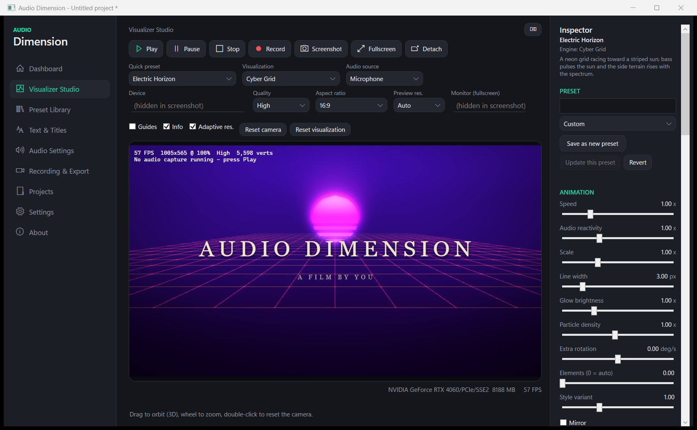
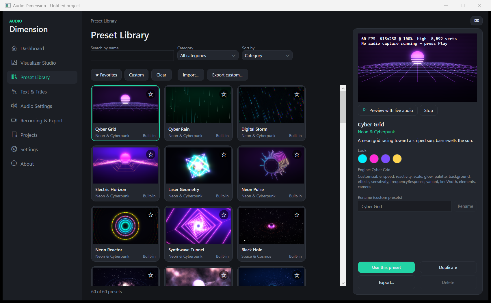
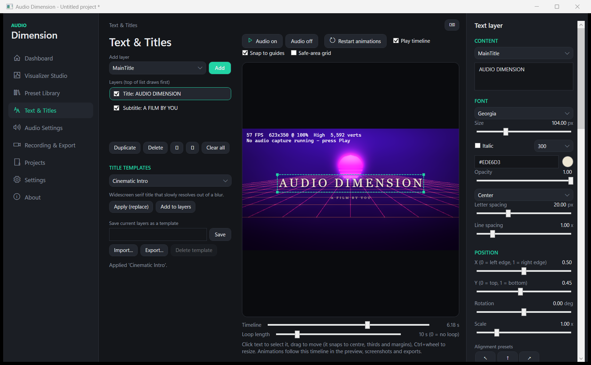
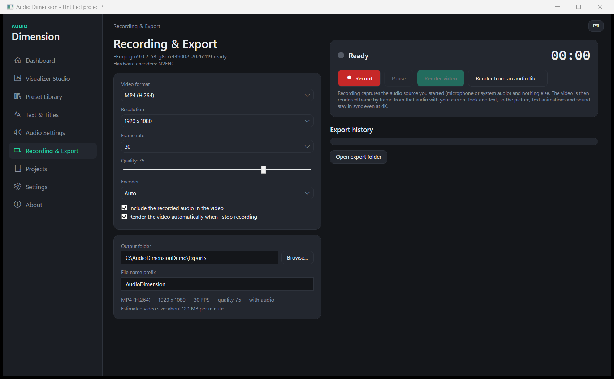
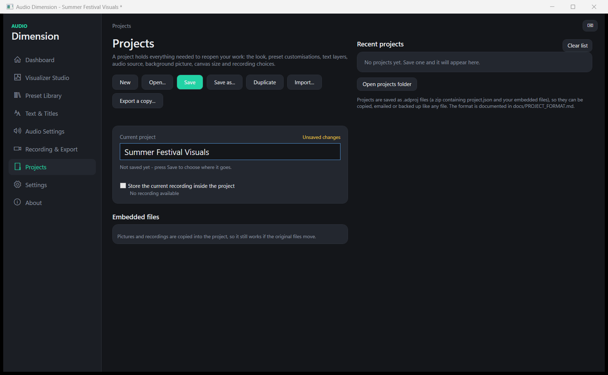
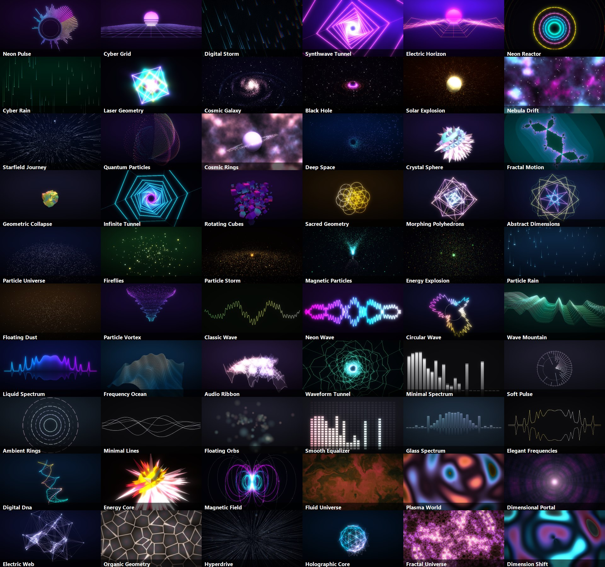
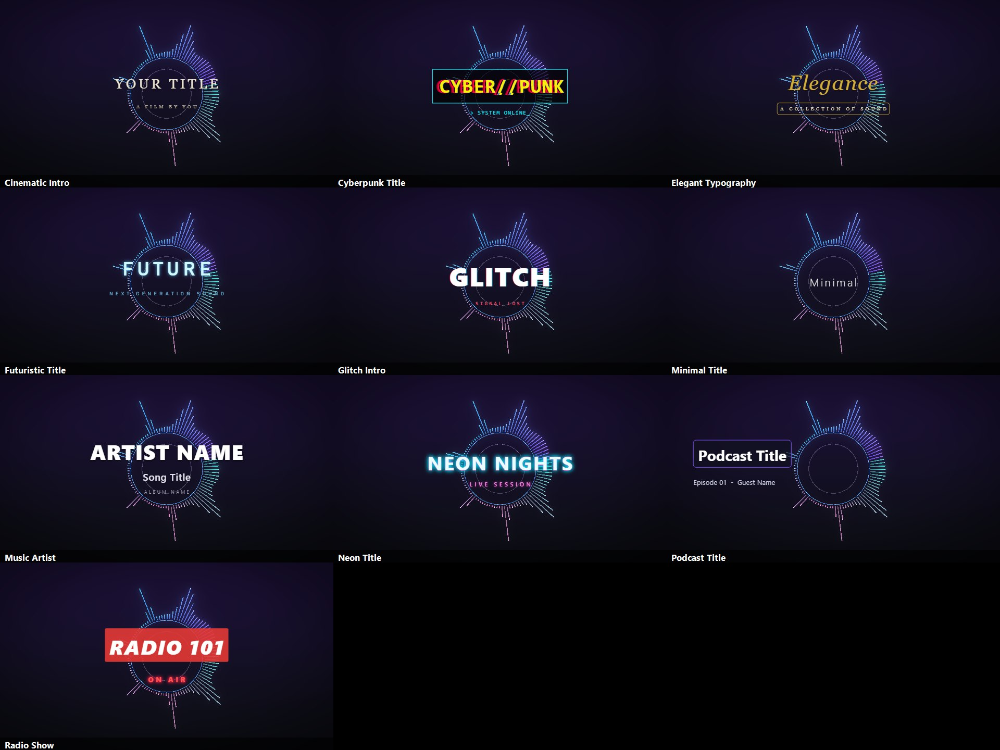

# Audio Dimension

**A real-time audio visualization and video studio for Windows.** Turn your microphone or whatever your PC is playing into GPU-rendered visuals, add animated titles, and render the result to a video file with the audio perfectly in sync.

> **Status: preview release (v1.0.0-preview.1).** The core of the app is built and tested (see [What works](#what-works) and [Known limitations](#known-limitations)). Polish, optimization and the installer are still in progress, so please treat this as a preview.



## About

Audio Dimension is a local-first desktop app (WPF + OpenGL, .NET 10) for musicians, streamers, podcasters and VJs who want good-looking audio visuals without a cloud service or an account. It captures **microphone** input or **system audio** (WASAPI loopback), analyses it with a real FFT, and drives 35 visualization engines and 60 ready-made presets from the actual sound. Everything runs on your machine: no telemetry, no uploads, no login.

## Highlights

- **Live audio from two sources:** any Windows microphone, or system audio via WASAPI loopback. Live level meters, 6-band analysis, beat detection, noise gate, auto gain and per-band sensitivity.
- **35 visualization engines, 60 presets:** spectrum, waveform, 3D, particle, geometric, fractal and fluid visuals across 7 categories. Search, filter, sort, favourite, duplicate, rename, import and export presets. Presets are plain data validated on import (never code).
- **Text and titles:** unlimited text layers (title, subtitle, artist, song, album, watermark, credits, social handle, captions) with full styling, 20 animation types, easing and timing, drag-to-position with snapping guides, and 10 ready-made title templates plus your own.
- **Video export with FFmpeg:** MP4 (H.264 / HEVC) and WebM (VP9) up to 4K, 24 to 60 fps, hardware encoding (NVENC / QuickSync / AMF) when available. Recording captures audio; the video is then rendered frame by frame from it, so picture, text animations and sound stay in sync regardless of how fast your PC renders.
- **Projects:** save everything (look, preset customisations, text, audio source, background picture, canvas size, export choices) to a single `.adproj` file with embedded assets. Missing or moved files never break a project.
- **Effects:** bloom, vignette, chromatic aberration, RGB separation, grain, scanlines, colour grading, distortion, blur, noise, motion blur, light rays; quality levels from Low to Ultra with automatic resolution scaling.
- **Screenshots** as PNG/JPEG up to 4K, including transparent backgrounds.

## Screenshots

| Preset Library | Text & Titles |
| --- | --- |
|  |  |
| **Recording & Export** | **Projects** |
|  |  |

All 60 presets:



The 10 title templates:



## Install

Windows 10 or 11 (x64). No .NET or FFmpeg install is needed.

1. Download **`AudioDimension-1.0.0-preview.1-win-x64-portable.zip`** from the [latest release](../../releases/latest).
2. Extract it anywhere and run **`AudioDimension.exe`**.

A Windows installer (Inno Setup script in [`installer/`](installer)) is not built yet; see [Known limitations](#known-limitations).

**macOS / Linux are not supported.** The app is built on Windows-only technology (WPF, WASAPI). A Mac version would need a separate port.

### First run
1. Open **Visualizer Studio**, pick a source (microphone or system audio) and press **Play**. The red pill at the top shows whenever audio is being captured; nothing is captured otherwise.
2. Pick a look from **Preset Library**, tweak it in the Inspector, add titles in **Text & Titles**.
3. Press **Record**, stop when you are done, and the video is rendered to your export folder.

## What works
All of the following is covered by automated tests (360 at the time of writing) and was exercised in the running app:

| Area | Notes |
| --- | --- |
| Audio capture and analysis | device enumeration, microphone and loopback capture, FFT, bands, beats, error handling and auto-reconnect |
| Rendering | 35 visualizers reacting to audio, all effects, quality tiers, deterministic offline rendering |
| Presets | 60 built-ins, custom presets, import/export with validation |
| Text and titles | 20 animations with timing tests, styling, 10 templates |
| Recording and export | H.264/HEVC/WebM, all frame rates, up to 4K, measured A/V sync, cancel, disk-space and encoder-failure handling |
| Projects | save/open/duplicate/import/export, embedded assets, hostile-file protection, dirty tracking |

## Known limitations
This is an honest list of what is **not** done yet:

- **No installer yet.** A portable ZIP is provided; the Inno Setup script is in the repo but has not been built or tested on a clean machine.
- **Polish and optimization is unfinished.** Frame times are good on the development GPU (all visualizers under 4 ms/frame at 1080p on an RTX 4060), but the **2 GB VRAM scenario has not been tested** on real hardware, and the memory-leak soak tests are not done.
- Some **Settings do not do anything yet**: *Anti-aliasing* and *VSync*. Preview frames are presented in sync by the Windows compositor.
- **Video backgrounds** are not implemented (picture backgrounds are).
- Presets are checked with synthetic audio in the automated tests; real music will look different.
- The Windows file Open/Save dialogs were not driven by automated tests.
- No code signing: Windows SmartScreen may warn on first run.

## Build from source
Requirements: Windows 10/11, the [.NET 10 SDK](https://dotnet.microsoft.com/download), a GPU with OpenGL 3.3.

```powershell
git clone https://github.com/unupunct/AUDIO-DIMENSION.git
cd AUDIO-DIMENSION
.\tools\get-ffmpeg.ps1          # downloads and verifies the bundled FFmpeg build (not stored in git)
dotnet build
dotnet test                      # 360 tests; some use your audio output device and play a brief quiet tone
dotnet run --project src/AudioDimension.App
```

Publish a self-contained build:

```powershell
dotnet publish src/AudioDimension.App -c Release -r win-x64 --self-contained true -o publish/AudioDimension
```

### Solution layout
| Project | Purpose |
| --- | --- |
| `AudioDimension.Core` | paths, SQLite, settings, logging |
| `AudioDimension.Audio` | WASAPI capture, FFT and band analysis |
| `AudioDimension.Visuals` | OpenGL renderer, 35 visualizers, effects, text overlay (SkiaSharp) |
| `AudioDimension.Presets` | preset model, validation, built-in catalogue, templates |
| `AudioDimension.Recording` | WAV capture, offline renderer, FFmpeg pipeline |
| `AudioDimension.Projects` | `.adproj` package format |
| `AudioDimension.App` | WPF application (MVVM) |
| `tools/` | thumbnail generator, benchmark, FFmpeg fetch script |

## Documentation
- [Preset schema](docs/PRESET_SCHEMA.md)
- [Project format](docs/PROJECT_FORMAT.md)
- [Manual test checklist](docs/MANUAL_TEST_CHECKLIST.md)
- [Third-party notices](THIRD_PARTY_NOTICES.md) (includes the FFmpeg GPL notice)
- [Changelog](CHANGELOG.md)

## Privacy
Audio Dimension works entirely offline. There is no telemetry, no account, no cloud dependency and nothing is uploaded. Audio is captured only while you have started a preview or a recording, and the app clearly shows when the microphone or system audio is active. User data lives in `%LOCALAPPDATA%\AudioDimension`.

## License
Audio Dimension's own code is released under the [MIT License](LICENSE). The bundled FFmpeg build is licensed under the GPL v3 and is run as a separate program; see [THIRD_PARTY_NOTICES.md](THIRD_PARTY_NOTICES.md).
